<div align="center">


<a href="https://github.com/Mahirlokare">

</a>

<br/><br/>


<br/><br/>


</div>

---

<div align="center">

# 👋 Hi, I'm Mahir

### B.E. CSE (AI & ML) Undergraduate · Aspiring AI Engineer

**Building practical software and AI-driven solutions for real-world problems.**

📍 India &nbsp; • &nbsp; 🤖 Artificial Intelligence &nbsp; • &nbsp; 🧠 Machine Learning &nbsp; • &nbsp; ⚡ Software Engineering

</div>

---

## `01` — WHO I AM

```python
mahir = {
    "identity": "Aspiring AI/ML Engineer",
    "education": "B.E. CSE (AI & ML) | 2023 - 2027",
    "institution": "AIKTC, New Panvel",

    "focus": [
        "Artificial Intelligence",
        "Machine Learning",
        "Deep Learning",
        "Generative AI",
        "Data Science",
        "AI Engineering"
    ],

    "programming": [
        "Python",
        "Java",
        "SQL",
        "JavaScript"
    ],

    "tools_and_frameworks": [
        "Scikit-learn",
        "XGBoost",
        "Pandas",
        "NumPy",
        "Streamlit",
        "React",
        "Node.js",
        "Git",
        "GitHub"
    ],

    "mindset": "Learn → Build → Test → Improve → Deploy"
}
```

I am a Computer Engineering undergraduate specializing in Artificial Intelligence and Machine Learning. I enjoy developing practical applications, experimenting with machine learning workflows, integrating APIs, and turning ideas into usable software.

My goal is to strengthen my engineering fundamentals and build reliable, end-to-end AI applications.

---

## `02` — WHAT I WORK WITH

<div align="center">

### PROGRAMMING

`Python` · `Java` · `SQL` · `JavaScript`

### MACHINE LEARNING & AI

`Scikit-learn` · `XGBoost` · `Model Evaluation` · `Feature Engineering` · `AI Applications`

### DATA & ANALYTICS

`Pandas` · `NumPy` · `Data Analysis` · `Data Visualization` · `Jupyter Notebook`

### WEB & APPLICATION DEVELOPMENT

`HTML` · `CSS` · `JavaScript` · `React` · `Node.js` · `Streamlit`

### ENGINEERING TOOLS

`Git` · `GitHub` · `VS Code` · `REST APIs` · `MySQL`

</div>

---

## `03` — TECH STACK

<div align="center">


<br/><br/>


</div>

---

## `04` — FEATURED PROJECTS

### 🌐 TrustVendor — Locality & Vendor Discovery Platform

A platform focused on helping users explore localities, discover vendors and services, and compare available options with supporting travel information.

**Stack:** `JavaScript` `React` `APIs` `Database` `AI Integration`

**Core work:**
- Locality exploration and comparison.
- Vendor and service discovery.
- API-based information retrieval.
- Travel and transportation options.
- Manual locality information submission.
- Database-backed locality information.

**Repository:** [TrustVendor](https://github.com/Mahirlokare/TrustVendor)

---

### 🌾 Farmer Advisory Agent — Multilingual Agricultural AI

A planned AI-powered agricultural advisory system intended to make useful crop and farming guidance more accessible to farmers across India.

**Planned capabilities:**
- Crop disease information and advisory.
- Multilingual interaction across Indian languages.
- Agricultural knowledge-base integration.
- Crop-specific guidance and question answering.
- Scalable data and retrieval architecture.

**Focus:** `Python` `AI/ML` `LLMs` `RAG` `Agricultural Data`

**Status:** Requirements discovery, planning and architecture.

---

### ⛓️ CertiChain — Blockchain Document Verification

A blockchain-based certificate verification project designed to support document authenticity checks and reduce certificate forgery.

**Stack:** `Solidity` `Ethereum` `SHA-256` `MetaMask` `Smart Contracts`

**Core work:**
- Certificate issuance and revocation.
- SHA-256 document hash verification.
- Blockchain-based certificate records.
- Public certificate verification.
- Owner-authorized operations.
- Duplicate and invalid record checks.

---

### 🎓 Helpmate — Student Assistance Platform

A web-based student assistance platform concept for bringing useful academic tools and student resources into one place.

**Stack:** `HTML` `CSS` `JavaScript`

**Core features:**
- CGPA conversion utility.
- Academic updates and resources.
- Holiday information.
- Student-oriented interface.
- Login functionality.

---

## `05` — HANDS-ON ENGINEERING

My practical learning is centered on building complete applications and understanding how their components work together.

- Developing web applications and interactive interfaces.
- Integrating APIs and working with application data.
- Building machine-learning workflows using Python libraries.
- Exploring smart contracts and blockchain-based verification.
- Using Git and GitHub to manage project code and collaboration.

---

## `06` — PROJECT MILESTONES

<div align="center">

### BUILDING ACROSS MULTIPLE DOMAINS

`AI & MACHINE LEARNING` &nbsp; `WEB DEVELOPMENT` &nbsp; `BLOCKCHAIN`

</div>

- **TrustVendor:** Developing a locality and vendor discovery experience.
- **Farmer Advisory Agent:** Planning a multilingual agricultural AI system.
- **CertiChain:** Working with document hashes and smart-contract-based verification.
- **Helpmate:** Exploring student-focused web application development.

I value practical implementation, clear problem definition, iterative testing, and continuous improvement.

---

## `07` — CURRENT DIRECTION

```text
             PROGRAMMING & DSA
                     |
                     v
              MACHINE LEARNING
                     |
                     v
               DEEP LEARNING
                     |
                     v
                 NLP & LLMs
                     |
                     v
               GENERATIVE AI
                     |
                     v
              AI APPLICATIONS
                     |
                     v
                PRODUCTION AI
```

**Long-term focus:** building AI systems that are useful, reliable, deployable, and engineered end-to-end.

---

## `08` — GITHUB STATISTICS

<div align="center">


<br/>


</div>

---

## `09` — CONTRIBUTION ACTIVITY

<div align="center">



</div>

---

## `10` — LET'S CONNECT

<div align="center">

<a href="https://github.com/Mahirlokare">

</a>

</div>

<br/>

<div align="center">

### **BUILD. LEARN. INNOVATE.**

**Turning Ideas Into Intelligent Solutions.**

<br/>


</div>
